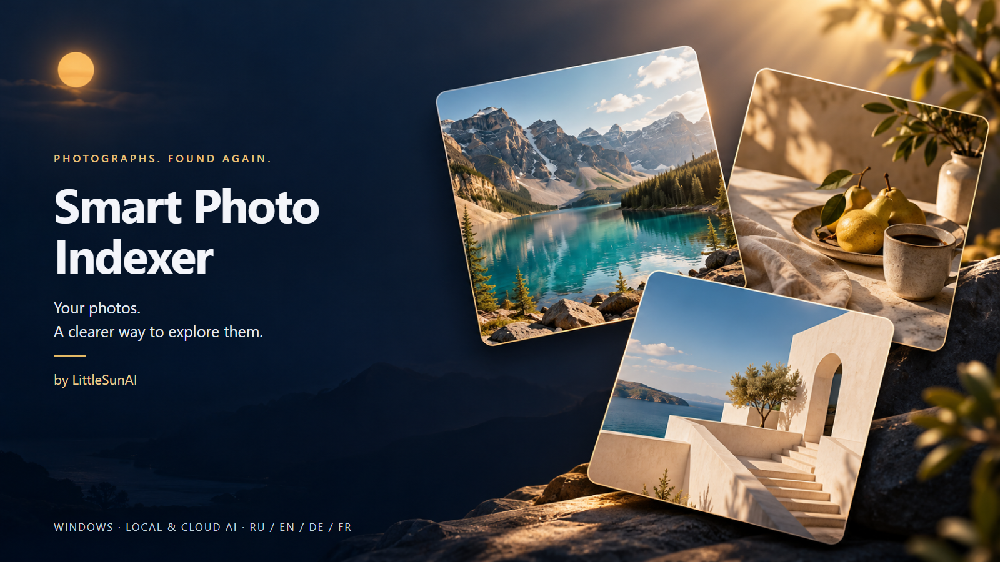
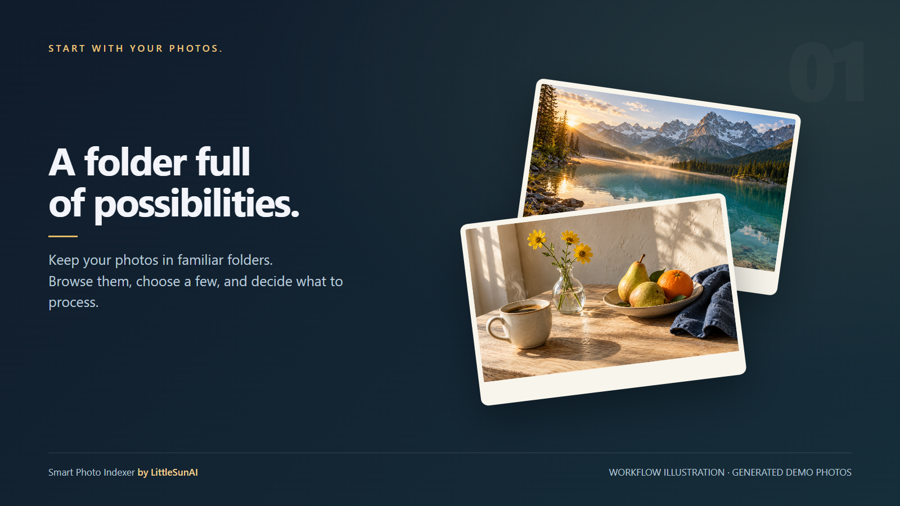
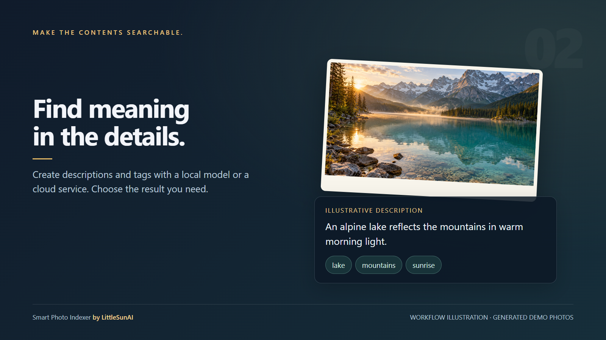
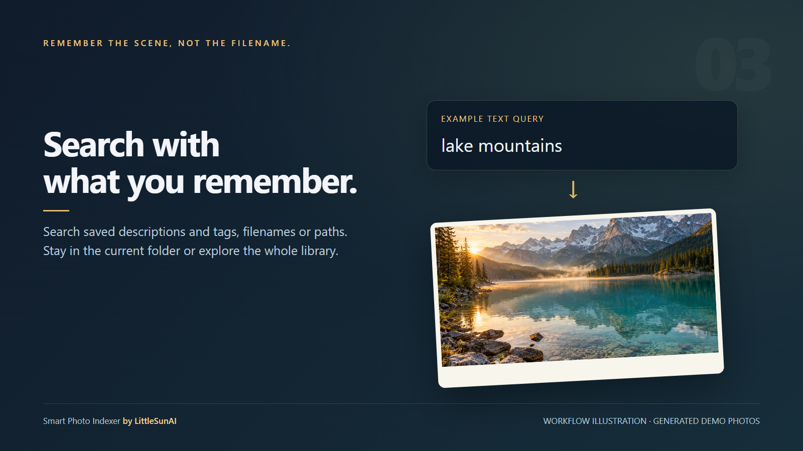
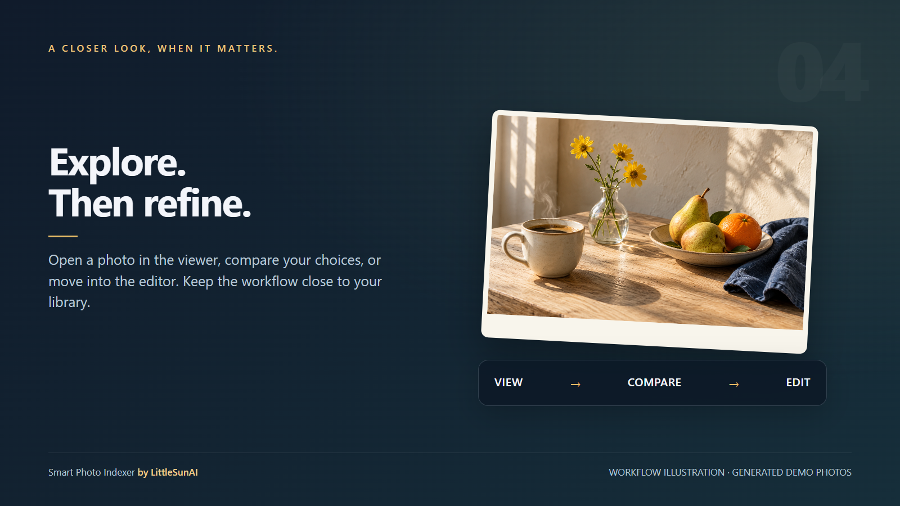
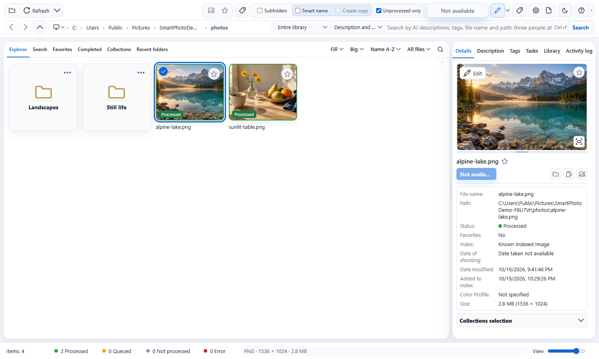
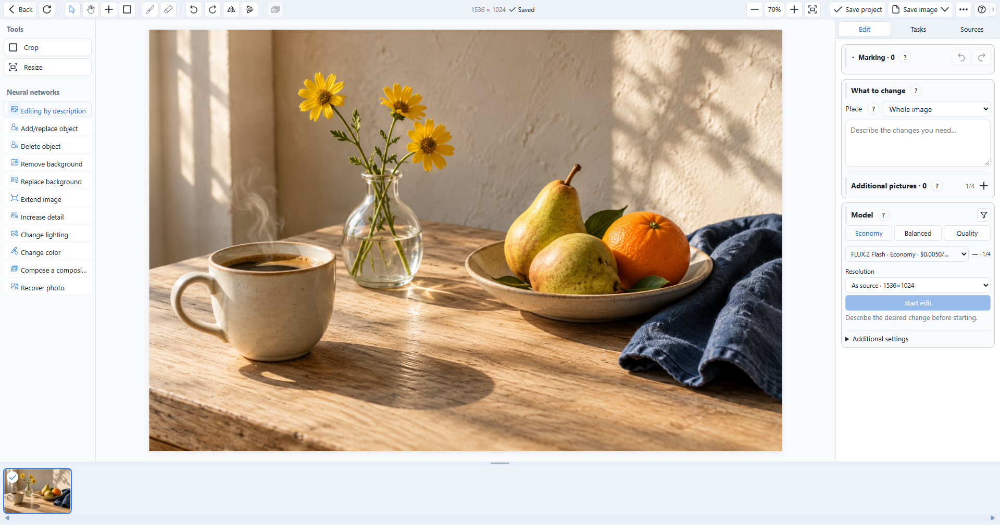
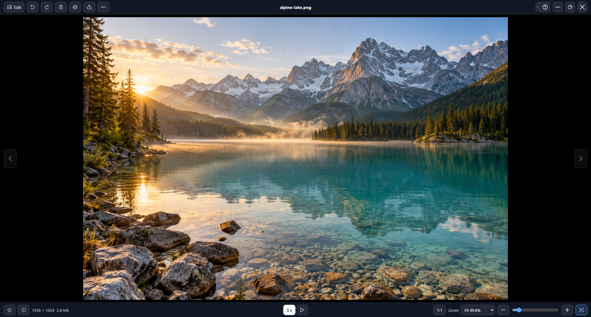

# Smart Photo Indexer

[English](README.md) · [Русский](README.ru.md) · [Deutsch](README.de.md) · [Français](README.fr.md)
<a href="docs/media/cover.png"></a>

**Eine Fotobibliothek, die sich mit Worten durchsuchen lässt.** Eine Windows-Anwendung von **LittleSunAI** zum Betrachten von Fotos, Erstellen von Beschreibungen und Tags, Durchsuchen gespeicherter Metadaten und Bearbeiten von Bildern.

**1.0.6 · Windows 10/11 x64 · RU / EN / DE / FR**

> Open-Source-Software von **LittleSunAI**, lizenziert unter der [Apache-Lizenz 2.0](LICENSE). Siehe [NOTICE](NOTICE) und [Lizenzinformationen](docs/LICENSING_STATUS.md).

OpenRouter ist bis zum Abschluss der Prüfung vorübergehend deaktiviert. Fal AI und lokale Modelle bleiben verfügbar; gespeicherte OpenRouter-Einstellungen und Zugangsdaten bleiben erhalten.

## Möglichkeiten

- Ordner als Raster, Liste oder Tabelle durchsuchen; Favoriten und Sammlungen verwenden.
- Beschreibungen, Tags oder beides mit einem lokalen Ollama-Modell oder einem separat eingerichteten Cloud-Dienst erstellen.
- Gespeicherte Beschreibungen, Tags, Dateinamen und Pfade im aktuellen Ordner oder in der gesamten indexierten Bibliothek durchsuchen. Es handelt sich um Textsuche, nicht um ein Versprechen einer vektorbasierten Ähnlichkeitssuche.
- Verarbeitungswarteschlangen vorbereiten und Fortschritt, Fehler sowie verfügbare Wiederholungen verfolgen.
- Einen eigenen Bildbetrachter mit Zoom, Verschieben und Diashow öffnen oder zum Editor für lokales Zuschneiden, Größenänderungen und unterstützte Cloud-Bearbeitungen wechseln.
- Stapel-Tags, XMP-Begleitdateien, Datenexporte und Editorprojekte verwenden. KI-Ergebnisse müssen weiterhin geprüft werden.
- Bearbeitungsvarianten als Baum ansehen, Bilder vergleichen und von einem gewählten Bild aus weiterarbeiten. Den Projektverlauf getrennt vom Bild speichern und Zwischendateien vor dem Bereinigen prüfen.

## Die Idee in Bildern

Vier Illustrationen erklären den Ablauf. Sie sind erklärende Darstellungen, keine erfundenen Programm-Screenshots. Die Fotos wurden generiert; Beschreibungen und Tags sind Beispiele.

[](docs/media/01-your-library.png)

**1. Einen Ordner auswählen.** Die Fotos bleiben in vertrauten Ordnern. Wählen Sie die Bilder aus, mit denen Sie arbeiten möchten.

[](docs/media/02-describe-and-tag.png)

**2. Inhalte beschreiben und mit Tags versehen.** Wählen Sie das gewünschte Ergebnis und lokale Verarbeitung oder einen Cloud-Dienst.

[](docs/media/03-search-by-words.png)

**3. Die Szene wiederfinden.** Durchsuchen Sie die bereits gespeicherten Informationen, ohne sich den Dateinamen merken zu müssen.

[](docs/media/04-view-and-refine.png)

**4. Genauer hinsehen.** Betrachten Sie ein Foto, vergleichen Sie Varianten und öffnen Sie bei Bedarf den Editor.

## Die tatsächliche Anwendung

Diese Aufnahmen zeigen die vorbereitete Anwendung. Beispielbeschreibungen und Tags wurden manuell eingegeben; für die Dokumentation war keine kostenpflichtige KI-Anfrage nötig. Öffnen Sie ein Bild, um das Original in voller Auflösung zu sehen.

[](docs/media/screenshot-library.png)

[](docs/media/screenshot-editor.png)

[](docs/media/screenshot-viewer.png)

## Installation und Einstieg

Das Windows-Installationsprogramm steht unter [Releases](https://github.com/LittleSunAI/smart-photo-indexer/releases/latest) bereit: `SmartPhoto-Setup-1.0.6-x64.exe`. Der Quellcode ist hier und als Source-code-Archiv verfügbar. Anleitungen und SHA256SUMS.txt sind separat beigefügt.

1. Installieren Sie die Windows-x64-Version. Für die normale Nutzung sind Node.js und Rust nicht erforderlich.
2. Öffnen Sie einen Ordner. Betrachten und Durchsuchen benötigen keinen KI-Schlüssel.
3. Bereiten Sie für die Erkennung ausdrücklich ein lokales Modell vor oder richten Sie Ihren eigenen Cloud-Schlüssel ein. Cloud-Vorgänge können Kosten verursachen.
4. Wählen Sie Beschreibung, Tags oder beides und prüfen Sie die erzeugten Angaben.
5. Die Sprache wird in den Einstellungen gewählt. **?** öffnet in jedem Fenster eine eigene Einführung und das Nachschlagewerk.

[Installationsanleitung](docs/INSTALL.de.md) · [Daten und Dienste](docs/DATA_AND_SERVICES.md)

## Erstellen, prüfen und beachten

Voraussetzungen und Windows-Builds: [BUILD.md](docs/BUILD.md). Die portablen Standardtests lesen keine gespeicherten Benutzerschlüssel, laden keine Modelle herunter und verwenden keine kostenpflichtigen APIs.

```powershell
npm ci
npm run verify:structure
npm test
npm run build
```

Der Installer ist noch nicht digital signiert. Modelle und Zugangsschlüssel sind nicht enthalten. Geschwindigkeit und Speicherbedarf lokaler Modelle hängen vom Computer ab; Cloud-Verfügbarkeit, Kosten und ausgegebene Bildgrößen vom Dienst. Nicht jedes Bearbeitungsmodell unterstützt Masken oder zusätzliche Bilder. Sichern Sie wichtige Originale vor ausdrücklichen Dateiänderungen.

## Autor und Drittanbieter

**LittleSunAI** — [AUTHORS.md](AUTHORS.md). Eigener Projektcode: [Apache-Lizenz 2.0](LICENSE), [NOTICE](NOTICE). Drittanbieter behalten ihre Bedingungen: [Hinweise](THIRD_PARTY_NOTICES.md), vollständige Texte unter `third-party-licenses/`.

[Fehler und Mitarbeit](CONTRIBUTING.md) · [Sicherheit](SECURITY.md) · [Änderungen](docs/RELEASE_NOTES.md)

[Prüfbericht zur Vorbereitung](docs/PREPARATION_AUDIT.md)
